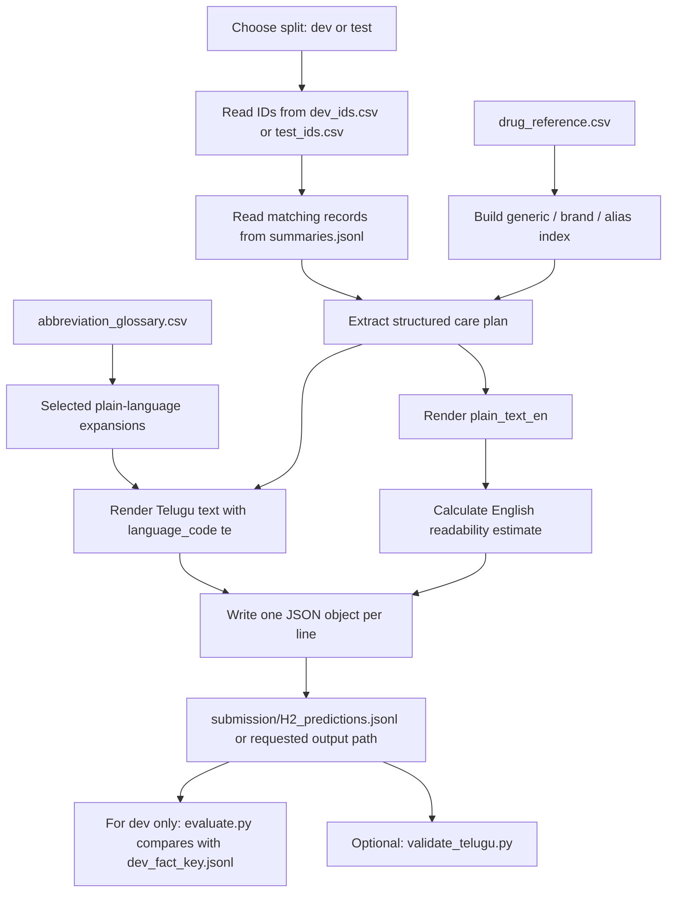

# H2 Project Explained: English + Telugu Discharge Care Plans

This guide explains the code and data in this repository in beginner-friendly terms. It is intended to help you understand the project well enough to explain its design choices, evaluation, and limitations—not to present it as a clinically validated product.

## 1. Project overview

### The problem

A hospital discharge summary records what happened during a hospital stay and what a patient should do after going home. It can contain short medical abbreviations, medicine brand names, compressed dose instructions, warning signs, and follow-up dates. For example:

```text
Injection Human Premix Insulin 30/70 10 U before breakfast, 4 U before dinner SC ½ hr before breakfast & dinner
```

This is compact for clinicians but may be difficult for patients or family members to follow. The project converts a summary into:

1. A **structured care plan**: separate fields for medicines, stop instructions, warnings, advice, and follow-up visits.
2. **Patient-facing English text**.
3. **Patient-facing Telugu text**, labelled with the language code `te`.
4. An English readability estimate.

The dataset is synthetic and the hospital is fictional. The intended beneficiaries in the scenario are patients and families who need discharge instructions presented more clearly. The program is a hackathon prototype; it is not a treatment decision system.

### Input and output

The generator takes a summary ID and its text from `data/summaries.jsonl`. It selects the IDs listed in `data/dev_ids.csv` or `data/test_ids.csv`. Its output is a JSON Lines file: one JSON object per selected summary.

Each prediction has this general shape:

```json
{
  "summary_id": "H2S-...",
  "care_plan": {
    "medicines": [],
    "stop_medicines": [],
    "warning_signs": [],
    "diet": [],
    "activity": [],
    "wound_care": [],
    "other_advice": [],
    "follow_ups": [],
    "continue_previous_medications": false,
    "continue_previous_text": null
  },
  "plain_text_en": "...",
  "translation": {"language_code": "te", "text": "..."},
  "readability": {"metric": "flesch_kincaid_grade", "score": 7.47}
}
```

The actual contents vary by summary. Empty advice or medicine lists are possible. A missing value that the parser cannot confidently extract is generally left `null` or omitted from the rendered instruction rather than filled by a guess.

## 2. How the complete system works

### Workflow



### Information passed between stages

1. `_load_ids` reads the requested split CSV and makes a set of summary IDs.
2. `main` loads the drug reference and abbreviation glossary, then reads `summaries.jsonl` one line at a time. Records not in the selected ID set are skipped.
3. `predict` calls `extract`, which creates the structured care plan from the summary text.
4. `_render_english` turns the structured fields into English text. `_render_telugu` separately builds Telugu text from those fields and the selected glossary expansions.
5. `readability_grade` calculates a Flesch–Kincaid-style estimate from the English text.
6. `main` writes a JSON object with `json.dumps(..., ensure_ascii=False)` and a newline. This preserves Telugu characters and makes each output record one JSONL line.
7. The validator checks the generated file against split IDs, schema and selected rendering consistency. Separately, the official evaluator can score development predictions against the public answer key.

The prediction generator does **not** call the evaluator and does not load development answer keys or gold-example outputs.

## 3. Repository and file guide

The working project directory is:

```text
E:\brocoders\H2_Dataset_AI_Work\H2_Discharge_Summary_to_Care_Plan
```

### Main files and folders

| Path | Role |
|---|---|
| `baseline/baseline.py` | Original, deliberately simple regex-based baseline. It is retained separately from the improved generator. |
| `evaluate.py` | Official benchmark evaluator. It validates prediction format, compares predictions with a supplied fact key, and reports the score and sub-scores. |
| `improved_solution.py` | Separate deterministic English + Telugu generator. This is the implementation that writes `language_code: "te"`. |
| `validate_telugu.py` | Additional input-only validator for Telugu predictions. It does not compare predictions to gold labels. |
| `README.md` | Original task pack and scoring documentation, with a section describing the local Telugu implementation. |
| `HACKATHON_DEMO.md` | Exact PowerShell workflow and a real source-to-English-to-Telugu example from the existing test output. |
| `PROJECT_EXPLAINED.md` | This beginner-friendly technical guide. |
| `data/` | Synthetic input summaries, split ID files, references, public development answer key, and reference examples. |
| `baseline/` | Contains the original baseline script. |
| `submission/` | Contains the final test prediction file expected by the task: `H2_predictions.jsonl`. |

### Important data files

| Data path | Actual role |
|---|---|
| `data/summaries.jsonl` | 2,000 JSON Lines records, each with `summary_id` and full summary `text`. This is the text input used by the generators. |
| `data/splits.csv` | All 2,000 IDs with a `split` value (`dev`, `test`, or `unlabelled`). Used when generating `--split all`. |
| `data/dev_ids.csv` | 200 public development IDs. Used for development predictions and validation. |
| `data/test_ids.csv` | 300 test IDs. Used to generate the final test submission. Test labels are not included here. |
| `data/dev_fact_key.jsonl` | 200 public development answer records, with structured medicine, stop, follow-up, and advice facts. Used for evaluation only—not generation. |
| `data/drug_reference.csv` | 81 rows mapping generics to brand names and aliases and giving strengths and a `used_at_discharge` flag. The improved generator uses it to recognize medicine names and avoid medicines marked as hospital-use-only. |
| `data/abbreviation_glossary.csv` | 257 rows with `abbreviation`, `expansion`, `plain_language`, and `category`. The generator uses only selected, unambiguous `plain_language` entries; it does not apply the whole glossary indiscriminately. |
| `data/gold_examples/` | 50 example folders containing a source summary, English/Hindi examples, and structured JSON. These are development material, not prediction-time input. |
| `data/gold_examples/index.csv` | Index of the example IDs. All 50 IDs overlap with public dev IDs. |
| `sample_submission.jsonl` | A format example from the original baseline. Its translation language code is `hi`; it is not the improved Telugu output. |

### Generated prediction and score files

These are output artifacts, not source code:

| Path | Meaning |
|---|---|
| `dev_predictions.jsonl` | Baseline predictions for dev when run with the commands below. |
| `baseline_score.json` | Saved official-evaluator report for the baseline dev predictions. |
| `dev_predictions_telugu.jsonl` | Improved English + Telugu dev predictions. |
| `telugu_dev_score.json` | Saved official-evaluator report for the improved dev predictions. |
| `submission/H2_predictions.jsonl` | Improved generator's final test predictions. |
| `dev_predictions_improved.jsonl`, `improved_score.json` | Additional earlier improved-run artifacts in the working directory. Check their language code/report metadata before treating them as the latest run; the reproducible current workflow names the Telugu files explicitly. |

Score JSON reports contain a `per_summary` list and can be large. They are useful for investigating individual development cases, but should not be mistaken for source files or hidden-test reports.

### Original, implementation, input, and evaluation categories

- **Original task files:** `baseline/baseline.py`, `evaluate.py`, original data, and task-pack portions of `README.md`.
- **Separate improved implementation:** `improved_solution.py` and `validate_telugu.py`.
- **Inputs:** summaries, split IDs, drug reference, and abbreviation glossary.
- **Evaluation-only answer data:** `dev_fact_key.jsonl`. It must not be used by the prediction generator.
- **Generated outputs:** prediction JSONL files and score JSON files.
- **Documentation:** `README.md`, `HACKATHON_DEMO.md`, and this guide.

There is no project-local `requirements.txt` or `pyproject.toml` in the inspected project-root listing. The README says the original baseline needs Python 3.9+ and pandas; `evaluate.py` imports numpy and pandas. The improved generator and Telugu validator use the Python standard library. The exact Python executable used on this machine is listed in Section 9.

## 4. Original baseline versus improved implementation

### What the original baseline does

`baseline/baseline.py` uses regular expressions to find medicine-like lines and parse some dose, frequency, duration and date patterns. It reads split IDs and source summaries, extracts stop and warning lines, then writes a submission-shaped JSONL file.

Its own docstring explicitly describes limitations: it does not map brand names to generics, does not specially handle tapers, split insulin doses or half tablets, and uses an English copy with `language_code: "hi"` for translation. Because the language code says Hindi while the text is English, the official translation script check fails. It also leaves `diet` and `activity` empty in its extracted care-plan object.

### What the improved generator adds

`improved_solution.py` is a distinct, standard-library implementation. It:

- loads medicine generics, brands, aliases, typical strengths and availability from the drug reference;
- limits medicine extraction to recognized discharge-medication sections;
- separates explicit stop instructions from discharge medicines;
- uses regular expressions for supported dose, frequency, timing, duration and date formats;
- parses warning/advice sections and dated follow-ups;
- constructs a structured care-plan dictionary before rendering prose;
- creates English text and rule-based Telugu text separately;
- writes `translation.language_code` as `"te"`;
- reports an English Flesch–Kincaid-style grade estimate.

The code is a rules-and-templates system; it does not contain a neural translation model or call a translation service.

### Medicine and advice extraction details

`build_drug_index` reads each CSV row. It normalizes the generic name, semicolon-separated brands and `also_known_as` values into searchable aliases. The `used_at_discharge` column becomes an `available` boolean.

`_medication_lines` begins at a recognized heading such as `TREATMENT ADVISED ON DISCHARGE` and stops at section breaks such as `GENERAL ADVICE`, `PLEASE STOP` or `REVIEW`. `_parse_medicines` looks for a medicine match in each extracted line. If a match is marked unavailable at discharge, the line is skipped as a take-home prescription. A medicine already seen by generic name is not added a second time.

`_strength_dose` includes specific patterns for two meal-slot insulin doses, numeric slot doses such as `1-0-1`, units such as `mg` or `IU`, tablet halves, and counts such as puffs. If an explicit amount is absent, it can use a number that matches a typical strength in the reference; if no supported pattern matches, the dose is `None`.

`_frequency` recognizes common codes such as `OD`, `BD`, `TDS`, `QID`, `HS`, `SOS` and `PRN`, slot patterns, and some meal/daily wording. It normalizes `TID` to `TDS` and `PRN` to `SOS`. `_timing` recognizes selected expressions such as after food, before breakfast, half an hour before meals, and bedtime. `_duration` searches for supported duration expressions, including days, weeks, months, lifelong and until next visit/review. These are finite patterns, not a general understanding of every possible prescription.

`_advice_sections` sorts lines into warning signs, diet, activity, wound care and other advice based on headings. `_followups` searches a follow-up/review section for dates, parses supported date formats, normalizes recognized dates to `YYYY-MM-DD`, and attempts to extract a clinic and purpose.

The structured medicine fields are `name`, `dose`, `frequency`, `timing`, `duration`, and `how_to_take_plain`. Routes do not have a dedicated top-level medicine field in the task schema: `_route_instruction` recognizes a few explicitly stated routes and `_dose_instructions` incorporates them into the plain instruction.

### English and Telugu rendering

`_render_english` places the structured plan into headings such as `MEDICINES`, `MEDICINES TO STOP`, `GET MEDICAL HELP NOW IF`, `OTHER INSTRUCTIONS` and `FOLLOW-UP VISITS`. The text is generated from the care-plan fields, not copied wholesale from the source.

`_render_telugu` similarly writes Telugu headings and medicine instructions. It delegates medicine frequency, timing, duration, route and advice clauses to functions such as `_frequency_te`, `_timing_te`, `_duration_te`, `_route_te` and `_telugu_clause`. Many source advice phrases are handled by explicit phrase rules. The glossary expansion function:

```python
plain = row.get("plain_language", "").strip()
if abbreviation not in patient_facing or len(values) != 1:
    continue
```

Here, `plain_language` is the human-friendly replacement. Only entries in a hard-coded allowlist are considered; ambiguous meanings and slash-separated meanings are skipped. The code does not blindly substitute the glossary's `expansion` column.

In the output, `language_code: "te"` tells the official evaluator which language script to check. It is a metadata label; it does not translate text by itself. Telugu words come from the renderer's phrase rules and templates. Drug names, numeric values and units are deliberately kept in Latin characters in the example output.

### Missing or uncertain information

The implementation is conservative in the sense that it does not intentionally make up a dose, timing, or duration when its parser finds no supported value; those structured values can remain `None`. It also records generic instructions to continue previous medicines without naming drugs that the summary did not identify.

This is not a guarantee that every unknown instruction is preserved perfectly. The parser recognizes known headings and formats; an unfamiliar heading, alias, wording, route, schedule, or advice clause may be missed or may pass through as English in the Telugu output. Rule order can also affect which translation rule handles a phrase. These behaviors are why a high benchmark score is not a clinical safety claim.

## 5. Explain the code

### `main`: command-line entry point

The bottom of `improved_solution.py` defines `main` and its command-line options:

```python
parser.add_argument("--split", choices=("dev", "test", "all"), default="test")
parser.add_argument("--out", type=Path, default=None)
parser.add_argument("--data_dir", type=Path, default=HERE / "data")
```

- `--split` chooses which IDs to process.
- `--out` overrides the default output path.
- `--data_dir` overrides the default `data` folder.

The default test output is `submission/H2_predictions.jsonl`. The generator creates its parent directory if needed. It tracks IDs already written and raises an error if the summaries file repeats an ID or if a requested ID is not found.

### `predict`: one summary to one output record

In simplified form, the real function does:

```python
cp = extract(text, drug_entries)
english = _render_english(cp)
telugu = _render_telugu(cp, glossary)
```

`cp` is a Python dictionary representing the structured care plan. Each renderer takes the same structured plan and produces different language text. The function then creates a JSON-compatible dictionary holding the summary ID, care plan, English text, Telugu translation and readability result.

### `extract`: building the structured plan

`extract` calls the medicine parser, scans a stop section, classifies advice, removes duplicate stop entries, searches for “continue previous medicines” wording, and creates the care-plan dictionary. This ordering matters: renderers consume the structured fields created here.

### Regular expressions and data structures

- A **regular expression** (regex) is a text pattern. For example, `DOSE_RE` looks for a number followed by a supported unit such as `mg`, `mcg`, `units`, `IU`, `ml`, `puffs`, tablets, capsules or drops.
- `DATE_RE` finds candidate dates. `_parse_date` then tries known date formats and rejects invalid calendar dates.
- `MED_HEADINGS` and `SECTION_BREAKS` are tuples of recognized headings. They control where medicine extraction starts and ends.
- A **dictionary** maps named fields to values, such as a medicine's `"dose"` and `"frequency"`.
- A **list** stores repeated items such as medicines, warnings and follow-up visits.
- A **set** is used for selected IDs and duplicate detection, so checking whether an ID was already seen is efficient.

For example, the public output stores dates as strings like `"2026-04-29"` and follows the field names that the evaluator expects. JSONL serialization writes each whole prediction on one line.

### Readability score

`readability_grade` estimates syllable counts from English word spelling and applies the Flesch–Kincaid grade-level equation. It reports an English score only; it is not a Telugu readability measure and the official evaluator states readability is reported, not scored.

## 6. Dataset and data flow

The data contains 2,000 summaries: 200 dev, 300 test and 1,500 unlabelled. `dev_ids.csv` and `test_ids.csv` provide the exact IDs for two runs; `splits.csv` holds the split assignment for all records.

The generator reads the selected IDs, then uses those IDs to filter records from `summaries.jsonl`. It also reads the drug and abbreviation references. It does **not** read `dev_fact_key.jsonl` or the gold-example folder during prediction.

The development fact key is an answer/reference file used by `evaluate.py` to compare a prediction to expected facts. It is appropriate to use it for development scoring; it is not appropriate to use its per-ID expected answers as input to prediction generation or to hardcode those answers into the generator. The hidden test key is unavailable to this local workflow.

The validator reads split IDs and source summaries so it can check selected cross-output consistency. It does not open the answer key or gold-example directory. The official evaluator reads the explicitly supplied truth file for scoring; its `load_sources` helper also reads `data/summaries.jsonl` for its source-copy check.

**Leakage/overfitting warning:** the 50 supplied gold-example IDs all appear in the 200 public dev IDs. Prior development work inspected the examples and iterated against dev scores. That history creates a substantial risk that the perfect dev result reflects tuning to overlapping public examples rather than performance on independent unseen cases.

## 7. Evaluation and results

### How the official evaluator works

Use the official script with a prediction JSONL and a truth JSONL:

```powershell
& $py .\evaluate.py --submission .\dev_predictions_telugu.jsonl --truth .\data\dev_fact_key.jsonl --out .\telugu_dev_score.json
```

The evaluator first parses JSONL and checks required fields and types. It matches predicted medicine names to expected generics, brands or aliases; checks dose, frequency, duration and follow-up dates; checks stopped medicines; and scores the English and translation text.

The structured sub-score uses weights defined at the top of `evaluate.py`:

| Component | Weight inside structured score |
|---|---:|
| Medicine recall | 0.30 |
| Dose exactness | 0.20 |
| Frequency exactness | 0.15 |
| Duration exactness | 0.10 |
| Follow-up date recall | 0.15 |
| Stop-instruction recall | 0.10, redistributed if the source has no stop instruction |

Penalties apply to dropped medicines, altered doses, invented medicines, incorrect stop entries and invented follow-up dates. The structured score after penalties is floored at zero.

The evaluator blends the structured score and text score as:

```text
per-summary score = 0.80 × structured-after-penalties + 0.20 × text score
text score = 0.50 × English text score + 0.50 × translation text score
```

The text score checks whether medicine names, dose information and dates are covered, penalizes invented drug mentions, and sets a text score to zero when too much text is copied from the source. Translation checks include native-script share, Latin/foreign word share, repeated-word share, length ratio to English, and common language words when the evaluator has a word list. Passing these checks indicates format/script characteristics; it does not prove that the translation is semantically correct.

### Measured development results

The saved reports show:

| Official evaluator result | Baseline | Improved English + Telugu |
|---|---:|---:|
| Public dev cases scored | 200 | 200 |
| Primary score | **0.5198** | **1.0000** |
| Medicine recall | 0.9983 | 1.0000 |
| Dose accuracy | 0.8500 | 1.0000 |
| Frequency accuracy | 0.8834 | 1.0000 |
| Duration accuracy | 0.9821 | 1.0000 |
| Follow-up date recall | 1.0000 | 1.0000 |
| Stop recall | 1.0000 | 1.0000 |
| English text coverage | 0.9255 | 1.0000 |
| Translation text coverage | 0.0000 | 1.0000 |
| Translations failing evaluator script checks | 200 | 0 |

These values come from the official evaluator output saved in `baseline_score.json` and `telugu_dev_score.json`. The improved score means the generated predictions matched the evaluator's checks on those 200 public development cases. It does **not** mean perfect real-world accuracy, clinical safety, native-speaker approval, or hidden-test performance.

The gold-example overlap and prior development iteration are important qualifications. Report this as a high dev benchmark result with an overfitting risk, not as proof the system will score 1.0 on unseen summaries.

## 8. Validation

### What `validate_telugu.py` checks

The validator:

- reads the expected split IDs and source summaries;
- parses every nonblank prediction line as JSON;
- checks required top-level fields, care-plan lists, medicine and follow-up fields, Telugu language code `te`, and a valid `YYYY-MM-DD` follow-up date;
- checks that every expected ID appears exactly once and that there are no unexpected IDs;
- checks that Telugu-script letters make up at least half the letters and that Devanagari characters are absent;
- checks translation length against the English text;
- checks that structured medicine names and dose numbers are represented in both rendered texts, follow-up dates appear in both texts, and selected Telugu section bullet counts match structured-list counts;
- checks that explicit stop medicine names and Telugu stop wording appear in the translation.

It reports the minimum Telugu script share found and says it reads only split IDs and source summaries. It does not read answer keys or gold examples.

### Four different meanings of “valid”

1. **JSON/JSONL validity:** each line parses as one JSON object.
2. **Schema validity:** required field names and types are present.
3. **Language/script validation:** the Telugu validator checks script share, absence of Devanagari and translation length. The official evaluator adds language-code-specific checks such as Latin/foreign word share, repeated-word share and common function words.
4. **Semantic correctness and clinical safety:** the plan preserves the meaning and is appropriate for a real patient.

The first three can be checked mechanically to a limited extent. They do not prove the fourth. The official evaluator also reports a metric score, but a score is a comparison to a benchmark answer key, not a clinical safety review. Neither validator verifies that a qualified clinician/pharmacist approved every medication instruction. A native Telugu speaker has not approved the phrase rules.

## 9. Exact commands to run the project

### Working directory and Python executable

The verified working directory is:

```text
E:\brocoders\H2_Dataset_AI_Work\H2_Discharge_Summary_to_Care_Plan
```

The verified Python executable for this machine is:

```text
C:\Users\pmlra\AppData\Local\Programs\Python\Python313\python.exe
```

Use the following PowerShell session. These paths and switches match the scripts' CLI definitions. `--data_dir` is omitted because all three scripts default to the project's `data` directory relative to their own file location.

```powershell
Set-Location 'E:\brocoders\H2_Dataset_AI_Work\H2_Discharge_Summary_to_Care_Plan'
$py = 'C:\Users\pmlra\AppData\Local\Programs\Python\Python313\python.exe'

# a. Generate baseline predictions for the 200 development IDs.
& $py .\baseline\baseline.py --split dev --out .\dev_predictions.jsonl

# b. Score those predictions against the public development fact key.
& $py .\evaluate.py --submission .\dev_predictions.jsonl --truth .\data\dev_fact_key.jsonl --out .\baseline_score.json

# c. Generate improved English + Telugu predictions for the same development IDs.
& $py .\improved_solution.py --split dev --out .\dev_predictions_telugu.jsonl

# d. Score the improved predictions using the same official evaluator and truth file.
& $py .\evaluate.py --submission .\dev_predictions_telugu.jsonl --truth .\data\dev_fact_key.jsonl --out .\telugu_dev_score.json

# e. Run the separate input-only Telugu validator on dev predictions.
& $py .\validate_telugu.py --submission .\dev_predictions_telugu.jsonl --split dev

# f. Generate the 300-case test submission at submission\H2_predictions.jsonl.
& $py .\improved_solution.py --split test

# g. Validate the generated test submission against test IDs and source summaries.
& $py .\validate_telugu.py --submission .\submission\H2_predictions.jsonl --split test
```

The baseline output goes to `dev_predictions.jsonl`; its report goes to `baseline_score.json`. The improved dev output and report are `dev_predictions_telugu.jsonl` and `telugu_dev_score.json`. The improved test command defaults to `submission/H2_predictions.jsonl`. Both generators accept `--out` to override the destination, and both generators plus the validator accept `--data_dir` to override the input data directory.

The official evaluator requires `--submission` and `--truth`; its optional `--out` selects the report path. Running the evaluator on dev uses the public `data/dev_fact_key.jsonl`. Do not substitute hidden test labels; they are not part of this local project.

The original baseline imports `pandas`. The official evaluator imports `numpy` and `pandas`. The improved generator and Telugu validator import only Python standard-library modules.

## 10. How to demonstrate the project

Use the real case `H2S-0HHVFAGP` documented in `HACKATHON_DEMO.md`:

1. Show the source lines containing the split insulin dose, medicines to continue, explicit Glimepiride stop, hypoglycemia warning, high-sugar warning and dated review.
2. Point to the structured medicine fields: the insulin dose is `10 units before breakfast, 4 units before dinner`; frequency is `BD`; timing is parsed as 30 minutes before breakfast and dinner. Show that `Glimepiride 2 mg` is under `stop_medicines`, not in active medicines.
3. Show the English text and Telugu output side by side. Point out that the numeric quantities, units, drug names and follow-up date remain recognizable, and the Telugu stop line still says to stop the medicine.
4. Explain the architecture as “identify source records → parse into structured fields → render two language versions → validate file structure and selected consistency.”
5. Show the official dev score report and identify it clearly as public development-set evaluation. Explain the overlap risk before anyone asks.
6. Close with the native-review and clinical-safety limitations. Do not frame the prototype as a medical device or advice for a real patient.

### Suggested judge questions and honest answers

**Why use rules instead of a large language model?**  
The current implementation is deterministic Python using the provided references and explicit patterns. It does not require an API, model download, or external service. That makes its behavior easier to reproduce, but limits its coverage of unfamiliar phrasing.

**How do you avoid inventing a medicine?**  
Medicine recognition uses the provided reference aliases and focuses on recognized discharge-medication sections. Unknown names can be missed, so this is not a guarantee. When a previous medicine is unnamed, the program records a generic “continue previous medicines” instruction rather than inventing a drug name.

**How do you know the Telugu is good?**  
We do not yet have native-speaker approval. The evaluator checks certain script and text properties, and our validator checks structure and selected consistency; neither one proves fluency or equivalent clinical meaning. Native-speaker review is a necessary next step.

**What does a 1.0000 score mean?**  
It means the official scorer returned 1.0000 over the 200 public dev examples for this run. All 50 supplied gold-example IDs overlap that dev set and prior tuning used those examples/dev feedback. It is not a hidden-test or real-world accuracy claim.

**Has a clinician or pharmacist checked the system?**  
No clinical-safety validation is confirmed. The dataset and references are hackathon materials, and the project must not be used to make real treatment decisions.

**What would you improve next?**  
Start with native Telugu review and clinician/pharmacist review, then create a genuinely independent evaluation set. After that, measure parser failures by instruction type and extend rules only when they can be tested for both correctness and regressions.

## 11. Limitations and responsible use

- **Overlap and overfitting:** all 50 gold-example IDs also occur in public dev. Prior iteration against the examples and dev score makes the reported dev result potentially overfit.
- **Telugu quality:** translation is hand-authored phrase rules and templates, not a validated translation engine. Native Telugu speakers should review idiom, grammar, medical terminology and comprehension.
- **Clinical safety:** no clinician/pharmacist clinical-safety validation has been performed. The source data is synthetic, and the drug reference/glossary are simplified for a hackathon.
- **Parser coverage:** regular expressions and recognized headings cover selected patterns. Unrecognized or unusually formatted instructions may be missed, mistranslated or left partly in English.
- **Evaluation coverage:** the official score measures agreement with the available fact key and its text checks. It does not measure patient comprehension, adverse events, or real-world outcomes.

This is a hackathon prototype for demonstration and evaluation—not a tool for real medical decisions. Real-world use would require domain-expert oversight, native-speaker validation, careful safety testing, and a human-in-the-loop process.

## 12. Glossary of technical terms

| Term | Simple explanation |
|---|---|
| Baseline | A simple starting implementation used for comparison. Here it is `baseline/baseline.py`. |
| JSONL | JSON Lines: a text file where each line is a separate JSON object. |
| Schema | The expected structure: field names, value types and required nesting. |
| Regex | A pattern used to find matching text, such as a number followed by `mg`. |
| Rule-based generation | Producing output using explicit conditions, patterns and templates rather than a trained text-generation model. |
| Recall | Of the items that should be found, the fraction the system actually found. Medicine recall is found source medicines divided by expected source medicines. |
| Development set (dev) | Publicly labelled examples used to develop and measure a system. Repeated tuning on dev can make its result optimistic. |
| Test set | Examples held for final evaluation. This project has 300 test IDs; their labels are not locally available. |
| Gold labels / fact key | Reference answers used to compare predictions. The dev fact key is public; test labels are hidden. |
| Data leakage | Information about evaluation answers influencing prediction generation or system decisions. Directly reading labels is leakage; tuning repeatedly on overlapping examples also undermines independence. |
| Overfitting | A system or set of rules fits known examples especially well but may perform worse on new cases. |
| CLI | Command-line interface: options such as `--split dev` passed when running a script. |
| Reproducibility | Another person can run the same code, inputs and commands and obtain the same process/results. |
| Canonicalization | Converting equivalent forms into one standard form, such as mapping `TID` to `TDS`. |
| Serialization | Turning an in-memory object into a file representation, here JSON text. |
| Unicode script | A writing system represented by ranges of Unicode characters, such as Telugu or Devanagari. |
| Semantic correctness | Whether the text actually preserves the source instruction's meaning. A valid JSON object can still be semantically wrong. |

## 13. My learning checklist

Study these in order before presenting:

1. **Explain the task and schema:** source summary in, structured plan plus English and Telugu out.
2. **Trace one case end to end:** follow `H2S-0HHVFAGP` from source JSONL through `predict` to the generated submission row.
3. **Describe file roles:** distinguish generator, validator, official evaluator, source data, public dev key and generated files.
4. **Explain selection:** show how `--split dev` and `--split test` choose IDs and how missing IDs cause an error.
5. **Explain medicine parsing:** describe the drug index, alias matching, discharge-section boundaries, dose/frequency/duration rules and stop list.
6. **Explain structured-first rendering:** explain why the English and Telugu renderers use one shared care-plan dictionary.
7. **Explain Telugu honestly:** describe `language_code: "te"`, phrase rules, glossary allowlist and need for native-speaker review.
8. **Explain official scoring:** know the 80/20 structure/text blend and what a 1.0000 dev score does—and does not—mean.
9. **Explain leakage/overfit risk:** state that all 50 gold-example IDs overlap dev and that prior tuning makes the result non-independent.
10. **State safety limits:** synthetic benchmark, no clinician/pharmacist validation, no hidden-test accuracy claim, not for patient care.

### Ten-question self-quiz

Try answering each question before reading its answer.

1. **What does the generator use as the source for a summary's text?**  
   **Answer:** The matching record in `data/summaries.jsonl`, selected using the IDs in the requested split file.

2. **Does `improved_solution.py` read `dev_fact_key.jsonl` to make predictions?**  
   **Answer:** No. That file is supplied to `evaluate.py` for development scoring; the generator reads split IDs, summaries and references.

3. **What does `language_code: "te"` do?**  
   **Answer:** It labels the translation as Telugu so the schema/evaluator can apply Telugu-specific checks. It does not itself translate the text.

4. **How does the improved generator identify brands?**  
   **Answer:** It builds searchable aliases from generic names, common brands and `also_known_as` values in `drug_reference.csv`.

5. **What happens when the dose parser cannot find a supported value?**  
   **Answer:** The structured dose can remain `None`; the program should not fill in a dose by guessing.

6. **What is the official evaluator's top-level score blend?**  
   **Answer:** 80% structured-after-penalties and 20% text score; the text score averages English and translation text scores equally.

7. **What does the Telugu validator prove?**  
   **Answer:** It checks structural/schema properties, split IDs, script properties and selected consistency such as medicine names, dose numbers, dates and list counts. It does not prove clinical or semantic correctness.

8. **What data causes the overfitting concern?**  
   **Answer:** All 50 supplied gold-example IDs are also among the 200 public dev IDs, and prior work tuned using those examples/dev scoring.

9. **Does 1.0000 on dev mean 100% accuracy on test or in a hospital?**  
   **Answer:** No. It is only the official evaluator's result on the public dev examples; it says nothing definitive about hidden test or real-world safety.

10. **What must happen before real-world use?**  
    **Answer:** At minimum, qualified clinician/pharmacist safety review, native-speaker Telugu review, independent testing, and a human-in-the-loop safety process. This project has not completed those steps.
